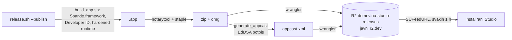

# Automatsko ažuriranje: Sparkle + R2 (13. 10. 2026.)

DOMOVINA Studio se od builda 38 ažurira sam. Po uzoru na
`adria-brainstormer/mac` (Notetaker), ali Studio nije Xcode projekt, pa bundle
slaže `scripts/build_app.sh`.

## Gdje je što

| Što | Gdje |
|---|---|
| Bucket | `domovina-studio-releases`, račun D.O.M., EEUR, `https://pub-3688cad79e324f92a17a1e66f96bd923.r2.dev` |
| Prva instalacija | `…r2.dev/DOMOVINA-Studio.dmg` (uvijek zadnja verzija) |
| Potpis | `Developer ID Application: ITalk d.o.o. (6SCK58757K)` |
| Notarizacija | ASC ključ ITalka `25KYCN22QD` (`~/.appstoreconnect/private_keys/`) |
| EdDSA privatni ključ | keychain, račun `domovina-studio`; kopija `/Volumes/DOMOVINA2TB/domovina_studio_build_files/credentials/sparkle-eddsa-private.key` |
| Arhivi | `/Volumes/DOMOVINA2TB/domovina_studio_build_files/dist/mac` (zip, izvor appcasta), `dist/mac-dmg` |
| Sparkle alati | `PodcastProducer/.build/artifacts/sparkle/Sparkle/bin` (dolaze sa SwiftPM paketom) |

> 🔴 Izgube li se obje kopije EdDSA ključa, nijedna instalacija više ne prihvaća
> update i svima se opet dijeli DMG ručno. Vanjski disk je jedna kopija, ne backup.

## Odluke i zamke

- **Developer ID i za lokalne buildove.** TCC pamti dozvolu za mikrofon i
  kameru po identifikatoru + timu, pa potpisan build zadržava dozvole iz builda
  u build. Ad-hoc potpis je hash binarnog, pa je svaki build ponovno pitao.
  Bez certifikata `build_app.sh` pada na ad-hoc i to kaže.
- **Hardened runtime bez entitlementa tiho uskrati kameru i mikrofon**, čak i
  uz TCC dozvolu: `PodcastProducer.entitlements` ima `device.camera` i
  `device.audio-input`. Studio nije sandboxiran, pa Sparkleovi XPC servisi i
  `mach-lookup` iznimke iz brainstormera ovdje ne trebaju.
- **Sparkle.framework ručno:** `ditto` u `Contents/Frameworks` (čuva simlinkove),
  `install_name_tool -add_rpath @executable_path/../Frameworks`, potpis iznutra
  prema van (Installer.xpc, Downloader.xpc, Autoupdate, Updater.app, framework,
  app), bez `--deep`.
- **CFBundleVersion = broj commitova grane.** `stable` ima manje commitova od
  `multicam`; objava sa `stable` nakon objave s `multicam` nikad se ne bi ponudila.
  Objavljuj s jedne grane. `release.sh --publish` odbija necommitane promjene.
- **generate_appcast čita ključ iz datoteke** (`--ed-key-file`), ne iz keychaina:
  drugi je binarni od `generate_keys`, pa bi ga keychain pitao dijalogom.
- **`codesign | grep -q` uz `pipefail` lažno pada** (grep zatvori cijev, codesign
  dobije SIGPIPE). Ispis ide u varijablu.
- **Samo arm64**: `swift build` gradi za arhitekturu stroja, appcast to i kaže.
- **Prijelaz s ad-hoc na Developer ID**: prvo pokretanje opet traži dozvolu za
  mikrofon/kameru, a keychain stavke koje je spremila stara verzija (R2 tajna,
  `tv.domovina.studio.r2`) traže lozinku pri prvom Snimaj. Jednom „Always
  Allow" i vrijedi za sve buduće buildove.
- Dok traje snimanje: `updaterMayCheck` vraća false, a skinuti update odgađa
  relaunch do kraja takea (`AppUpdater`). **Nije isprobano na pravom takeu.**

## Provjereno 13. 10.

- Build 37 iz scratchpada ponudio je i instalirao testni build 9000 i sam se
  ponovno pokrenuo; `spctl`: `Notarized Developer ID`. Testni objekti obrisani.
- Build 38 iz `/Applications` je preko izbornika našao build 39, instalirao ga
  i ponovno se pokrenuo.

## Vezani dokumenti

- [`2026-10-13-multicam.md`](2026-10-13-multicam.md) — build 39 donosi orkestraciju telefona
