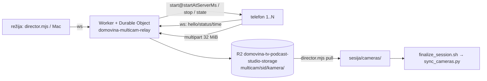

# Multicam: telefoni kao dodatne kamere (2026-10-13)

Telefoni (Android/iOS) snimaju samostalno i lokalno. Mreža nosi samo upravljanje
i upload nakon stopa. Poravnanje se radi u postu, **zvukom** (studio) ili
**satom relaya** (stadion). Protokol: [`multicam/PROTOCOL.md`](../multicam/PROTOCOL.md).

## Gdje je što

| | |
|---|---|
| Relay | `multicam/relay` → `https://domovina-multicam-relay.d-o-m.workers.dev`, account D.O.M. Ključ: `~/.config/domovina-multicam/key` (Worker secret `MULTICAM_KEY`), nikad u repou |
| Režija | `node multicam/director.mjs join|watch|status|start|stop|wait-uploaded|pull|fake-camera`, soba iz `MULTICAM_ROOM` (zadano `studio`) |
| Android | `multicam/android` (Kotlin, CameraX 1.6, AGP 9.2) — README za build/install |
| iOS | `multicam/ios` (SwiftUI, XcodeGen, tim 6SCK58757K, AVAssetWriter) — README |
| Post | `scripts/sync_cameras.py`; `finalize_session.sh` sam pronađe `<sesija>/cameras` |
| Testovi | `scripts/test_sync_cameras.sh` (u `scripts/test.sh`) |

## Mjerenja koja su odredila dizajn

- **Zvuk, sintetika** (jeka sobe, drift ±80 ppm, kamere prije/poslije miksa):
  pomak točan na 0,02 ms, bljesak na pravi frame.
- **Zvuk, stvarni telefoni** (Moto Edge 30 Ultra + Moto G86, govor s Maca):
  rezidual 0,01 ms RMS; drift telefona prema Macu −0,3 i −2,4 ppm; telefoni su
  krenuli 42 ms razmaka.
- **Sat prema zvuku** (isti telefoni, 3 min): pomak između telefona po satu
  46,4 ms, po zvuku 39,2 ms → **7 ms**, uz min RTT 28 ms. Na drugom takeu −3,7 ms
  — predznak se mijenja, to je mrežni šum, ne stalna greška telefona.
- **Sat, sintetika** (RTT 25 ms – 2 s, asimetrična ruta, 3 min bez mreže):
  početak točan na 0,7 ms.
- **Android fileZero**: CameraX `Recorder.mFirstRecordingVideoDataTimeUs` (refleksija)
  poklapa se s Camera2 senzorskim vremenom na < 0,001 ms; obje Motorole imaju
  `SENSOR_INFO_TIMESTAMP_SOURCE=REALTIME`. Rezerva (`status-min`) kasni 85–95 ms.
- **CameraX start latencija** 120–200 ms → aplikacija je uči i kreće ranije;
  zakazani start pada unutar ~±40 ms od cilja.
- **Frame rate**: Edge 30 fps, G86 **29,97** — post čita vrijeme iz datoteke,
  nikad ne pretpostavlja 30.
- **Relay WebSocket**: 6 min s Maca, 0 prekida. iOS je vidio „Connection reset by
  peer" svakih 2–3 min — strana telefona/mreže, ponovno spajanje za 1–2 s.

## Odbačeno, i zašto

- **Zvuk kao sinkronizacija na stadionu.** Zvuk prijeđe 100 m za ~290 ms;
  korelacija mjeri akustičko kašnjenje do svakog telefona, ne razliku satova.
  Zato `--sync clock`.
- **„Izravni put" heuristika u GCC-PHAT** (uzmi zadnji vrh do 30 ms iza najvišeg,
  protiv jeke). Na sintetici s gustim bijelim IR-om pomogla je, na stvarnom
  govoru preskakala je na bočne vrhove visine glasa (18–41 ms greške). Uz
  fizikalan IR (izravni zvuk + stol + zidovi + difuzni rep) čisti maksimum je
  točan — heuristika je izbačena.
- **Jedan prolaz s prozorima od 20 s.** PHAT vrh je širok jedan uzorak, a 60 ppm
  rastegne 20 s za ~10 uzoraka → razmazan vrh, krivi pomak. Sada: 4 s prozori za
  drift, pa 20 s prozori izobličeni za taj drift.
- **`asetrate` za rastezanje zvuka po ppm**: prima samo cijele Hz. Umjesto toga
  `asetpts=PTS*b` + `aresample` s mekom kompenzacijom (izmjereno: stalni zaostatak
  ~1 ms, ne raste s duljinom).
- **Uzorak sata samo pri spajanju** (prva verzija): ±20–50 ms. Sada svakih 5 s
  cijelo vrijeme, u postu iz svake minute uzorci blizu lokalnog min-RTT, težinski pravac.

## Zamke

- Mac ima samo ~5 GB slobodno na `/`. Testne snimke idu na
  `/Volumes/DOMOVINA2TB/multicam_test/`.
- Homebrew ffmpeg nema `drawtext` → grid ide bez natpisa (skripta to detektira).
- Probni miks s PodMica bio je −63 dB i nije čuo govor: zvuk Maca ide na
  „External Headphones". Za probu treba PodMic uz izvor zvuka.
- iOS dozvola za kameru/mikrofon ne može se dati s Maca; Android može
  (`adb shell pm grant`).
- Refleksija na privatno CameraX polje — provjeriti nakon svake nadogradnje CameraX.

## Otvoreno

1. **iPhone snimanje nije testirano** — na SE 2nd i 12 mini treba jednom dodirnuti
   „Dopusti" (kamera + mikrofon). Zatim test kao za Android (start/stop, ffprobe,
   sat prema zvuku).
2. Proba s pravim RØDE miksom kao masterom (`finalize_session.sh` na sesiji s `cameras/`).
3. A/V pomak unutar telefona po modelu (pljesak) → `--av-offset`.
4. Mac Studio: Start/Stop šalje i telefonima (sessionId = Studio sessionID), popis
   kamera u sučelju, Post preuzima kamere (`director.mjs pull`).
5. Dugi takeovi (90–180 min): baterija, toplina; Android foreground service; iOS u
   pozadini prekida take.
6. Rubni slučajevi: istekao multipart uploadId (beskonačni retry), take prekinut
   gašenjem aplikacije ostaje neispravan mp4.
7. Montaža: automatski rez na govornika (diarizacija postoji) ili FCPXML za DaVinci.
8. Pospremiti probne objekte u R2 (`multicam/relaytest1`, `android-t*`, `real1`,
   `t1-smoke`, `a-sched-2`, `b-audio`, `c1-gap`, `c2-offstop`, `statetest-*`).
9. Grana `multicam` je odvojena od `stable` — spajanje nije traženo.

## Vezani dokumenti

- [`LIP_SYNC_THEORY.md`](LIP_SYNC_THEORY.md) — zašto host clock nije lip sync; ista logika „zvuk putuje sa slikom"
- [`multicam/PROTOCOL.md`](../multicam/PROTOCOL.md)
- [`MULTICAM_ARHITEKTURA.md`](MULTICAM_ARHITEKTURA.md) — pregled za vanjske čitatelje, s dijagramima
