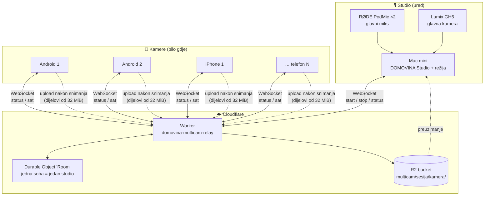
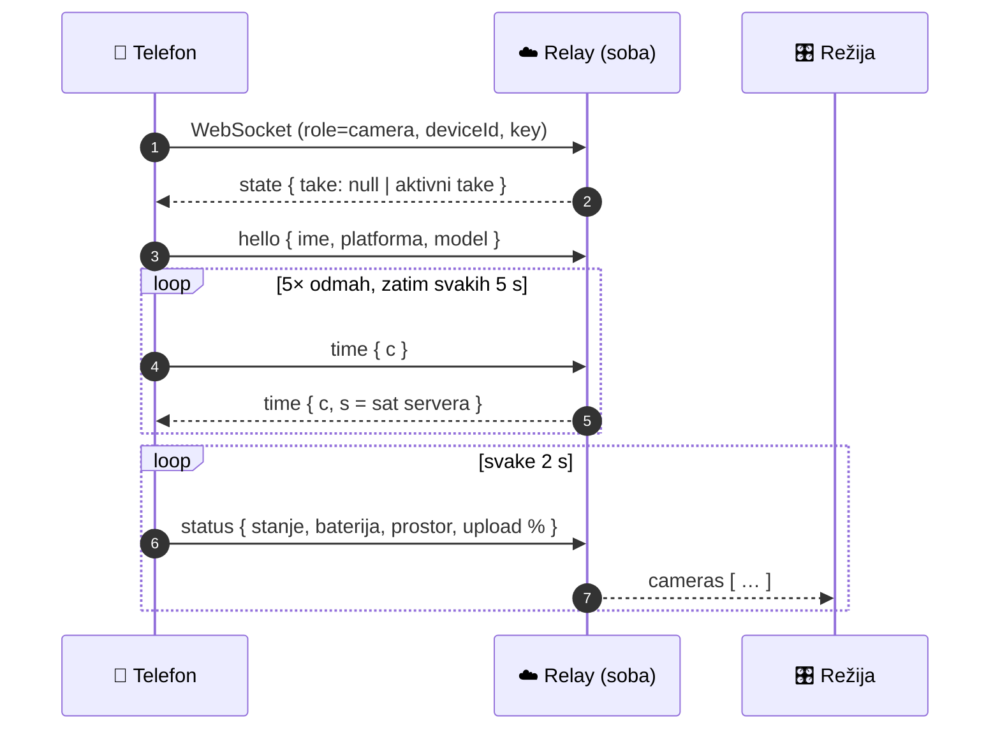
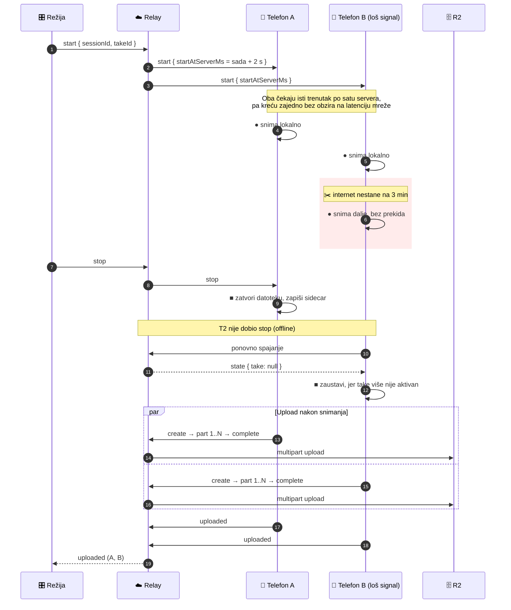
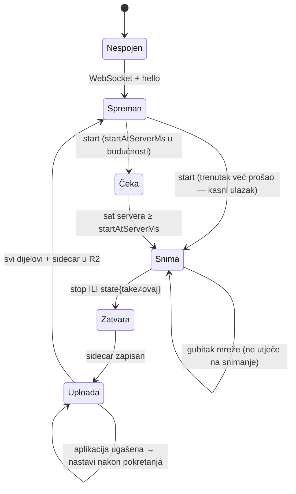
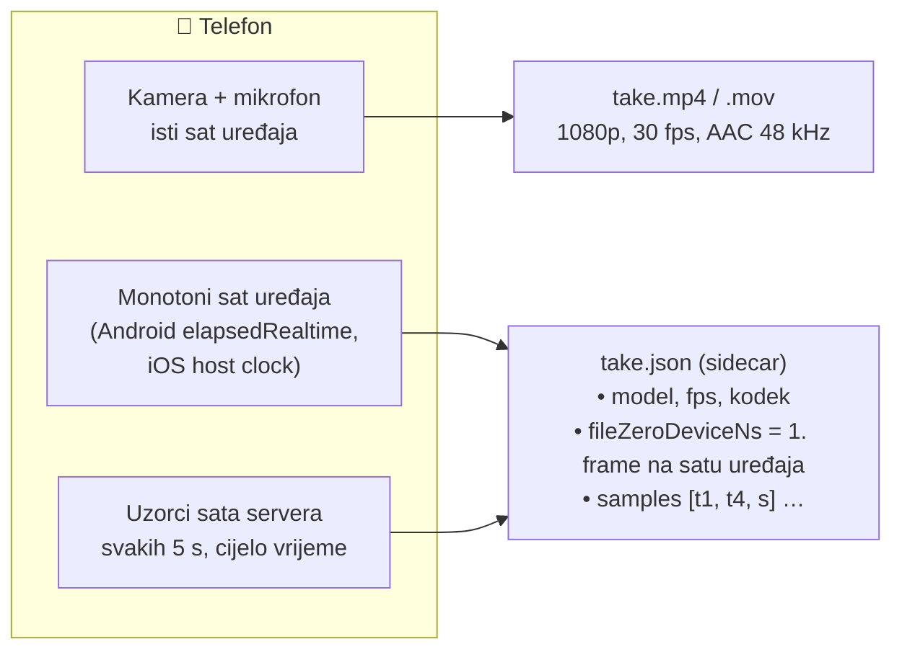
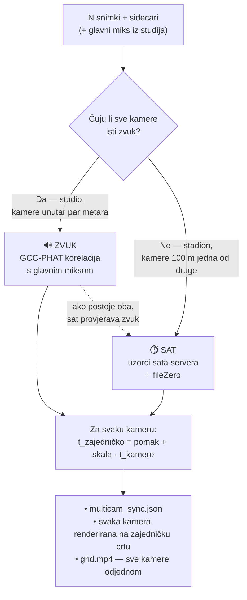
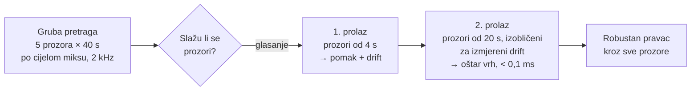
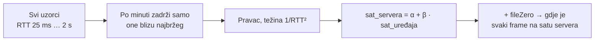
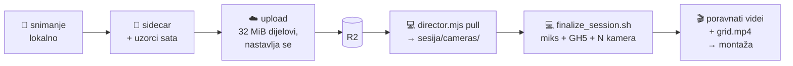

# DOMOVINA Multicam — arhitektura

Bilo koji broj telefona (Android i iPhone) radi kao dodatne kamere uz studio. Svaki
telefon snima **samostalno i lokalno**. Internet služi samo za upravljanje i za
upload nakon snimanja. Sve kamere se nakon toga u postprodukciji poravnaju na
zajedničku vremensku crtu, **zvukom** ili **satom servera**, s točnošću unutar
jednog framea.

Primjeri upotrebe: podcast s više kutova u studiju, ili šest telefona oko
nogometnog igrališta s nestabilnim mobilnim internetom i studijem u uredu.

> Detalji protokola: [`multicam/PROTOCOL.md`](../multicam/PROTOCOL.md) ·
> mjerenja i odluke: [`2026-10-13-multicam.md`](2026-10-13-multicam.md)

---

## 1. Sustav na jednoj slici



**Glavno načelo:** preko mreže nikad ne putuje video u stvarnom vremenu. Telefon
koji izgubi internet nastavlja snimati, a kad se veza vrati, nastavi tamo gdje je
stao.

---

## 2. Komponente

| Komponenta | Tehnologija | Uloga |
|---|---|---|
| **Android aplikacija** | Kotlin, Jetpack Compose, CameraX | 1080p, konstantan fps, slika i zvuk u istoj datoteci, upload koji se nastavlja nakon prekida |
| **iOS aplikacija** | SwiftUI, AVFoundation (AVAssetWriter) | Isto, plus točno vrijeme prvog framea na satu uređaja |
| **Relay** | Cloudflare Worker + Durable Object | Soba s kamerama, prosljeđivanje naredbi, referentni sat, upload u R2 |
| **Pohrana** | Cloudflare R2 | `multicam/<sesija>/<kamera>/<snimka>.mp4` + sidecar `.json` |
| **Režija** | `director.mjs` (Node), kasnije Mac aplikacija | Tko je spojen, start/stop, preuzimanje |
| **Post** | `sync_cameras.py` (Python, NumPy/SciPy, ffmpeg) | Poravnanje N kamera, render na zajedničku crtu, mreža svih kamera za provjeru |

---

## 3. Spajanje telefona

Jedan link nosi sve postavke i ujedno je sadržaj QR koda. Telefon ga skenira
jednom, zapamti postavke i od tada se spaja sam.

```
domovinacam://join?relay=…&room=studio&key=…&name=gol-sjever
```



---

## 4. Tijek jedne snimke



---

## 5. Stanja aplikacije na telefonu



---

## 6. Što telefon zapisuje

Svaka snimka daje dvije datoteke.



- **Slika i zvuk u istoj datoteci, na istom satu.** Zato je zvuk iz kamere
  pouzdan pokazatelj gdje joj je slika.
- **`fileZeroDeviceNs`** veže prvi frame za sat uređaja s točnošću ispod
  milisekunde. Na Androidu se čita iz CameraX-a i provjerava prema senzorskom
  vremenu kamere, a na iOS-u je to vrijeme prvog framea koji je primio AVAssetWriter.
- **Uzorci sata** kažu koliko je sat uređaja bio ispred ili iza sata servera, u
  mnogo trenutaka kroz cijelu snimku.

---

## 7. Poravnanje u postprodukciji: dva načina



### Zašto dva načina

Zvuk putuje 343 m/s. Telefon 100 m od suca zviždaljku čuje **~290 ms kasnije**
(~9 frameova) od telefona pokraj njega. Na igralištu bi zato korelacija zvuka
mjerila udaljenost od izvora zvuka, a ne razliku između kamera. U studiju su
kamere blizu i zvuk je najtočnija metoda.

| | Zvuk | Sat servera |
|---|---|---|
| Kada | Studio, kamere čuju istu prostoriju | Stadion, teren, bilo koja udaljenost |
| Treba | Glavni miks ili jednu kameru kao referencu | Da je telefon bio spojen barem povremeno |
| Izmjerena točnost | **0,01 ms** (stvarni telefoni) | **~7 ms** prema zvuku (stvarni telefoni) · 0,7 ms (simulacija s RTT do 2 s) |
| Jedan frame (30 fps) | 33 ms | 33 ms |

### Zvuk, u dva prolaza



Drift je razlika u brzini kristala dvaju uređaja, obično 2 do 80 ppm. Na 80 ppm
to je 0,4 s kroz 90 minuta, pa se ispravlja, a ne zanemaruje.

### Sat, s lošom mrežom



Kod sporih uzoraka nije jasno koliki je dio vremena otišao u kojem smjeru, pa se
odbacuju. Rupe u mreži samo smanje broj uzoraka. Pravac kroz cijelu snimku i
dalje izmjeri i pomak i drift.

---

## 8. Protok podataka od kamere do montaže



| Što | Veličina |
|---|---|
| Video po telefonu (1080p, ~16 Mbit/s) | ~7 GB po satu |
| Nogometna utakmica, 6 telefona, ~100 min | ~70 GB ukupno, upload nakon utakmice (Wi-Fi) |
| Upravljački promet tijekom snimanja | nekoliko kB/s po telefonu |

---

## 9. Pouzdanost

| Situacija | Ponašanje |
|---|---|
| Internet nestane tijekom snimanja | Snimanje se nastavlja; uzorci sata se nastave nakon povratka |
| Stop stigne dok je telefon offline | Pri ponovnom spajanju relay javi `state: nema takea` → telefon zaustavi i uploada |
| Telefon se spoji usred snimke | Odmah dobije `start` i priključi se (kasni ulazak) |
| Upload pukne ili se aplikacija ugasi | Popis dijelova je spremljen na disk; nastavlja se nakon pokretanja |
| Kamera bez zvuka ili bez podataka o satu | Prijavi se kao neuspjela; ostale kamere i audio se normalno obrade |

---

## 10. Status (2026-10-13)

| | Stanje |
|---|---|
| Relay + R2 | ✅ u produkciji, provjeren |
| Android (Moto Edge 30 Ultra, Moto G86) | ✅ provjereno na uređajima: snimanje, upload, rupe u mreži, sat |
| iOS (iPhone SE 2nd, 12 mini) | 🟡 builda se, instalira i spaja na relay; snimanje čeka dozvolu za kameru na uređaju |
| Post (zvuk + sat) | ✅ sintetički i stvarni testovi prolaze |
| Upravljanje iz Mac Studio aplikacije | ⏳ sljedeći korak |
| Automatski rez na govornika | ⏳ planirano |
